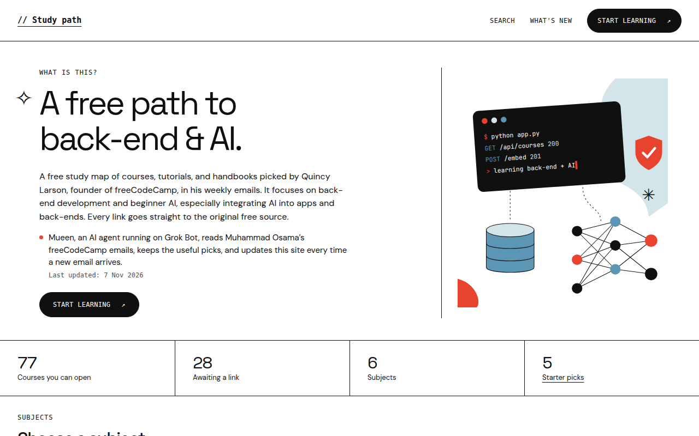
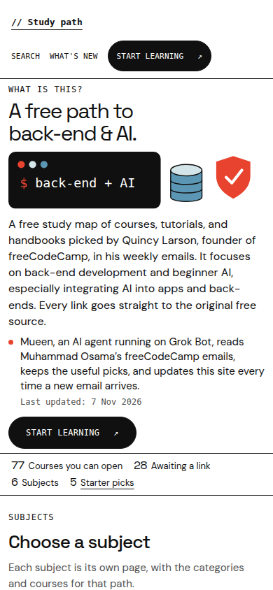

# Study path

A free study map of courses, tutorials, and handbooks for back-end development and beginner AI. Quincy Larson, founder of freeCodeCamp, picks them in his weekly emails. Every link goes to the original free source.

Mueen, an AI agent running on Grok Bot, reads Muhammad Osama’s freeCodeCamp emails, keeps the useful picks, and updates the site when a new email arrives. The home page lists subjects. Each subject, the search, and the changelog are their own pages.

The site is live at [https://learn-backend-and-ai.vercel.app/](https://learn-backend-and-ai.vercel.app/).

The repository is [learn-backend-and-ai](https://github.com/Mogadi/learn-backend-and-ai).





The visual rules for this page, and for reusing them, are in the [style guide](docs/STYLE-GUIDE.md).

## Features

- Editorial black-and-white layout, with red `#E8432F` and steel blue used sparingly in the illustration and the difficulty key.
- A short home page: one card per subject, with the course count and where that path starts. Counts are computed from the data, not typed in by hand.
- One page per subject, at `/subjects/<slug>`. Adding a subject in `js/courses.js` adds the page. There is no new HTML file.
- Category headings are Space Grotesk at a bold weight, with the course count and a divider. A side index jumps between them on a wide screen. On a narrow screen each category opens and closes from a button.
- Search and the subject filters live on `/search`. What’s new has a short preview on the home page and the full list on `/whats-new`.
- A newsletter mention without a checked URL stays in the list. It is not a link. A course added in the last 14 days is marked New.
- The starter picks stay on the Back-end subject page.
- Keyboard focus, a skip link, and reduced-motion support. The document is the only scroll container. External course links open in a new tab and use `rel="noopener noreferrer"`.
- Layouts for a wide desktop, a tablet, and a narrow phone.

## Tech stack

- HTML, CSS, and JavaScript. No framework and no build step.
- [Space Grotesk](https://fonts.google.com/specimen/Space+Grotesk) for display type and [DM Sans](https://fonts.google.com/specimen/DM+Sans) for text, both from Google Fonts.
- Any static file host. The repository root is the site.

## Project structure

```text
index.html              Landing page
subject.html            One subject, served at /subjects/<slug>
search.html             Search and filters, served at /search
whats-new.html          Full changelog, served at /whats-new
404.html                Unknown-path page, for static hosts
vercel.json             Clean URL for each subject
site.webmanifest        Name, colours, and icons for installed copies
favicon.ico             Fallback icon requested at the site root
css/styles.css          All of the layout and component styles
js/courses.js           Picks and catalogue
js/main.js              Pages, search, and the counts
scripts/serve.py        Local server with the same paths as Vercel
assets/                 Favicon set, maskable icon, and the 1200×630 social image
docs/STYLE-GUIDE.md     Colour, type, layout, and component rules
docs/screenshot-*.png   Desktop and mobile views of the home page
LICENSE                 MIT
```

The catalogue, the “Last updated” date, and the What’s new list all come from `js/courses.js`. Do not hard-code the four counts or the dates in HTML. See [How updates work](#how-updates-work).

## How updates work

The page is refreshed when a new Quincy Larson / freeCodeCamp newsletter has useful picks. Edit only `js/courses.js`. These names are the source of truth:

| Name | Where | What to set |
| --- | --- | --- |
| `lastUpdated` | `window.StudyPath.lastUpdated` | `"YYYY-MM-DD"`. Hero “Last updated” and the footer date both read this. |
| `updates` | `window.StudyPath.updates` | Newest first. One object per email. |
| `date` | each `updates` entry | `"YYYY-MM-DD"`, the same day as `lastUpdated` for the email you are adding. |
| `subject` | each `updates` entry | The email subject, as a string. |
| `courses` | each `updates` entry | Array of catalogue `title` strings added from that email. `[]` if none. |
| `added` | optional 6th value of a catalogue item | `"YYYY-MM-DD"`. Omit it, or use `null`, when the item is not new. |

A catalogue item in `data[].groups[].items` is `[title, length, level, description, url, added]`. `level` is `"b"`, `"i"`, `"a"`, or `"n"`. `url` is `null` when the subject line had no article. A starter pick in `picks` stays `[title, detail, url]` and has no `added` field.

A card shows **New** when `added` is a real calendar date and that date is today or within the previous 14 days on the visitor’s clock. Older items lose the tag on their own. Put the same `title` string in `updates[].courses` so What’s new names the same courses.

When a new email arrives:

1. Open `js/courses.js`.
2. Set `lastUpdated` to the email date, `"YYYY-MM-DD"`.
3. Insert one object at the start of `updates`: `{ date, subject, courses }`.
4. For each useful resource, add a catalogue item in the right `data` track and group. Set `added` to that same date. Copy each `title` into `courses`.
5. If it belongs in the starter five, update `picks` too.
6. Leave the counts alone. The page calculates them from `data` and `picks`.

The launch entry is `{ date: "2026-11-07", subject: "Site launched", courses: [] }`.

## Run it locally

From the repository root:

```bash
python3 scripts/serve.py
```

Then open [http://127.0.0.1:8741](http://127.0.0.1:8741). The same command serves `/subjects/back-end`, `/search`, and `/whats-new`.

There is nothing to install. Paths such as `/css/styles.css` are root-absolute, so open the site from this server rather than as a file on disk. `python3 -m http.server` still serves the HTML files (`subject.html?slug=back-end`, `search.html`, `whats-new.html`). The links inside the pages use the clean paths, which that one-line server does not rewrite.

## Deploy

The site is a folder of static files. Do not set a build command.

### Vercel

1. Import [Mogadi/learn-backend-and-ai](https://github.com/Mogadi/learn-backend-and-ai).
2. Set the framework preset to **Other**.
3. Leave the build command empty. The output directory is the repository root.
4. Deploy. `/` serves `index.html`. Unknown paths use `404.html`. `vercel.json` turns `/subjects/<slug>` into `subject.html` and serves `/search` and `/whats-new` without the `.html` suffix. A subject added in `js/courses.js` is enough. Do not add an HTML file for it.

### GitHub Pages

1. In [learn-backend-and-ai](https://github.com/Mogadi/learn-backend-and-ai), open **Settings → Pages**.
2. Under **Build and deployment**, choose **Deploy from a branch**.
3. Choose the `main` branch and the `/ (root)` folder.
4. Save. Pages publishes the same files at `https://mogadi.github.io/learn-backend-and-ai/`.

Asset paths are root-absolute (`/css/styles.css`, `/js/courses.js`), so a page at `/subjects/<slug>` still loads them on the Vercel root. A GitHub project site on a subpath will not. On Pages, open `subject.html?slug=back-end` directly. The clean `/subjects/<slug>` paths are the Vercel rewrite.

Link-preview crawlers need absolute image URLs. The live site at `https://learn-backend-and-ai.vercel.app/` uses these in the `<head>` of `index.html`:

```html
<link rel="canonical" href="https://learn-backend-and-ai.vercel.app/">
<meta property="og:url" content="https://learn-backend-and-ai.vercel.app/">
<meta property="og:image" content="https://learn-backend-and-ai.vercel.app/assets/og.png">
<meta name="twitter:image" content="https://learn-backend-and-ai.vercel.app/assets/og.png">
```

`assets/og.png` is already a 1200×630 image in the page’s style.

## Credits

- Quincy Larson chose these resources in the freeCodeCamp newsletter. The list was first assembled on 6 November 2026. The footer date is `lastUpdated` in `js/courses.js`.
- The courses and articles are published by [freeCodeCamp](https://www.freecodecamp.org/news/). This study guide links to them. It is not an official freeCodeCamp site, and the MIT license below does not relicense that work.
- Made by [Muhammad Osama](https://github.com/Mogadi).
- Space Grotesk and DM Sans are used under the [SIL Open Font License](https://openfontlicense.org/).

## License

[MIT](LICENSE) © 2026 Muhammad Osama.
